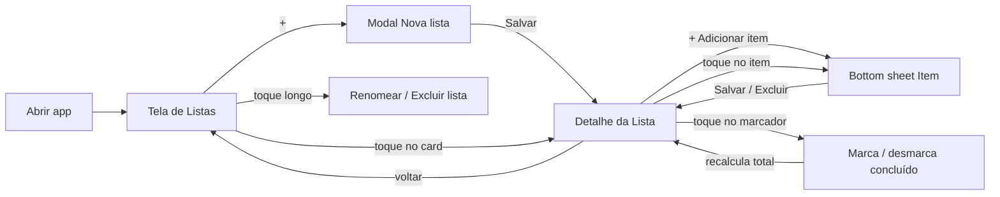
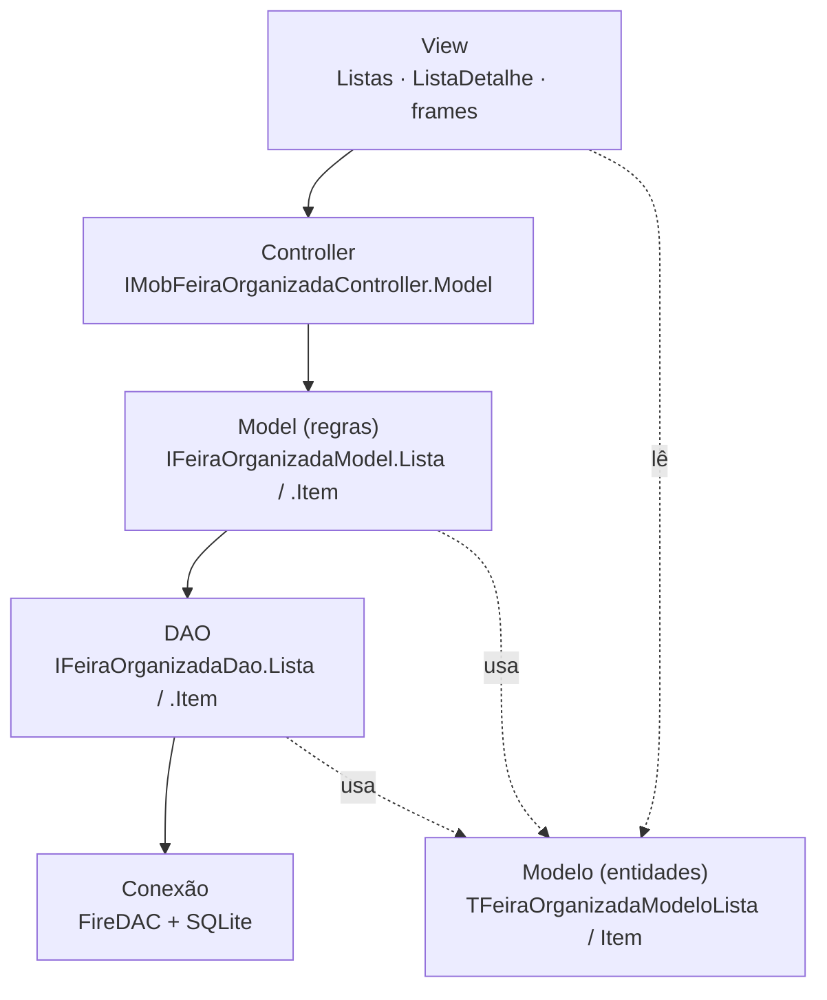
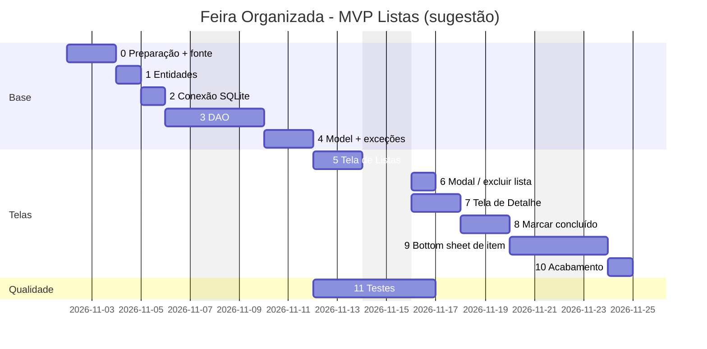

# Feira Organizada — Planejamento do MVP "Listas de Feira"

> Documento de refinamento. **Nenhum código foi alterado ainda**: aqui ficam as telas, as camadas, as decisões e a ordem das etapas.
> O mock visual das telas está em [`mock-telas.html`](mock-telas.html) (abrir no navegador).

---

## 1. Objetivo

Permitir que o usuário monte listas de feira, lance os itens de cada lista (descrição, quantidade e valor unitário), **marque os itens como concluídos** conforme compra e veja o **total dos itens concluídos** no rodapé da tela de detalhe.

### Escopo do MVP

| Dentro | Fora (por enquanto) |
| --- | --- |
| CRUD de listas (criar, renomear, excluir) | Login / cadastro / Firebase |
| CRUD de itens dentro da lista | Sincronização na nuvem |
| Itens só em **unidade** (`UN`, quantidade inteira) | Itens por peso (`KG`, quantidade decimal) |
| Marcar / desmarcar item como **concluído** | Histórico de preços, categorias, compartilhar lista |
| Total da lista = soma **só dos itens concluídos** | Orçamento / limite de gasto por lista |
| Persistência **local** (SQLite) | |

### Regra do totalizador

- Item **não concluído**: aparece na lista com seu subtotal em cinza, mas **não entra no total**.
- Item **concluído**: subtotal em destaque e **entra no total**.
- Marcar ou desmarcar recalcula o total na hora.
- Como informação secundária, o rodapé mostra quantos itens já foram concluídos e o **valor previsto** (soma de todos os itens), para o usuário ter noção de quanto falta.

---

## 2. Identidade visual (extraída do app atual)

Tudo vem de `uFrmLogin.fmx` e `uFancyDialog.pas`, para as telas novas ficarem com a mesma cara da tela de login.

| Token | Valor | Onde já é usado |
| --- | --- | --- |
| Fundo | `#181F3D` (`xFF181F3D`) | `Fill.Color` do form e dos `recBack*` |
| Superfície / campo | `#232C51` (`xFF232C51`) | Retângulos dos campos de e-mail/senha |
| Borda | `#286993` (`xFF286993`) | `Stroke.Color` dos campos |
| Primária (ação) | `#DF255C` (`xFFDF255C`) | Botões "Vamos começar!", Login, Cadastrar, botão do FancyDialog |
| Texto | Branco (`claWhite`) | Labels e edits |
| Fonte | **Consolas**, títulos 20, corpo 14 (padrão), negrito nos botões | Todos os `TextSettings.Font.Family` |
| Raio | 10 nos campos, 20 nos botões | `XRadius` |
| Dialog | Card branco, título `#2C2C2C` (19), mensagem `#848484` (15) | `TFancyDialog` |
| Status | Verde `#35BD27`, Vermelho `#E64D4D`, Azul `#3085D6`, Laranja `#F3A867`, Cinza `#AAAAAA` | Ícones do `TFancyDialog` |
| Ilustração | `img/oie_transparent (1).png` (barraca de feira, fundo transparente) | Tela inicial e login |

Proposta: centralizar esses valores numa unit de constantes (ver Etapa 0) para não repetir `$FFDF255C` espalhado pelas telas.

### Ajustes adotados

Comparação visual que levou à decisão: seção "Comparação de fontes" do [`mock-telas.html`](mock-telas.html).

- **Fonte: Nunito (embutida no app)** — decidido. Substitui a Consolas em todas as telas, inclusive no login.
  - Motivo: a **Consolas só existe no Windows** (no Android o FMX cai para Roboto e no iOS para a fonte do sistema, então o celular nunca a mostra) e, por ser monoespaçada, dá visual de editor de código. A Nunito é arredondada e combina com a ilustração da barraca.
  - Pesos usados: **Regular (400)** para texto, **Bold (700)** para títulos, botões e valores, **ExtraBold (800)** só no total do rodapé.
  - Licença: SIL Open Font License — pode ser distribuída junto com o app; manter o `OFL.txt` junto dos arquivos.
  - Tamanhos continuam os de hoje: títulos 20, corpo 14, secundário 11–12.
- **Verde do concluído: `#2E9E22`** — o `#35BD27` com ✓ branco tinha contraste ~2,5:1 (mínimo para ícone é 3:1); o novo fica em ~3,5:1. O `TFancyDialog` pode continuar com o verde antigo no ícone de sucesso (é contorno, não fundo).
- **Números**: algarismos de largura fixa nos valores para alinhar a coluna de preços (no FMX, alinhar os valores à direita num `TLabel` de largura fixa já resolve na prática).
- **Cores base** (azul-marinho + rosa `#DF255C`): mantidas. Branco sobre o rosa tem contraste ~4,6:1.

### Como embutir a Nunito no FMX (a validar na Etapa 0)

| Plataforma | O que fazer |
| --- | --- |
| Todas | Baixar os `.ttf` **estáticos** (não a versão variável) de Regular, Bold e ExtraBold para `Fontes/res/fonts/` (pasta proposta), junto com o `OFL.txt`. |
| Android | Adicionar os `.ttf` no *Deployment* com caminho remoto `assets\internal\`. Validar qual nome de família o FMX reconhece (nome da família ou nome do arquivo sem extensão) e como o negrito é resolvido. |
| iOS | Adicionar os `.ttf` no *Deployment* (raiz do bundle) e registrar a chave `UIAppFonts` no `info.plist.TemplateiOS.xml`. |
| Windows (dev) | Instalar a fonte na máquina de desenvolvimento para o designer do IDE e o Win32 mostrarem igual ao celular. |

A família e os pesos ficam centralizados na unit `FeiraOrganizada.Tema`, para trocar em um lugar só se algo não funcionar numa plataforma.

---

## 3. Telas

### 3.1 Tela de Listas (tela inicial)

Passa a ser a **primeira tela do app** (o `frmLogin` sai do `Application.CreateForm` inicial, mas continua no projeto).

- **Cabeçalho**: título "Minhas Listas" + subtítulo com a quantidade de listas.
- **Lista de cards** (`TVertScrollBox` com um frame por lista, ou `TListView` com aparência customizada):
  - Nome da lista;
  - Data de criação;
  - Itens concluídos / total de itens (ex.: `4 de 6 itens`);
  - Total da lista **dos itens concluídos** (em destaque, à direita).
- **Botão flutuante "+"** (círculo `#DF255C`) no canto inferior direito → abre o modal "Nova lista".
- **Estado vazio**: ilustração da barraca + texto "Você ainda não tem listas" + botão "Criar minha primeira lista".
- **Ações no card**: toque → abre o Detalhe; toque longo (ou ícone `⋮`) → menu com "Renomear" e "Excluir".
- **Excluir**: confirmação pelo `TFancyDialog` (ícone de alerta, botões "Excluir" / "Cancelar"). Excluir a lista exclui seus itens.

### 3.2 Modal Nova lista / Renomear lista

- Overlay escuro + card na cor de superfície, no mesmo padrão do campo de login (fundo `#232C51`, borda `#286993`, raio 10).
- Campo "Nome da lista" (obrigatório, máx. 60 caracteres). Sugestão de nome padrão: `Feira dd/mm`.
- Botões "Salvar" (primário) e "Cancelar" (texto).
- Validação: nome vazio → mensagem de erro (exceção → `TFancyDialog`).

### 3.3 Tela de Detalhe da Lista (itens)

- **Cabeçalho**: botão voltar `‹`, nome da lista, ícone para renomear.
- **Itens** (um por linha):
  - **Marcador de concluído** à esquerda (círculo vazio com borda `#286993`; concluído = círculo verde `#35BD27` com ✓);
  - Descrição;
  - `qtd UN × R$ unitário` em texto secundário;
  - Subtotal (qtd × unitário) à direita: branco/negrito se concluído, cinza se não;
  - Toque no **marcador** → marca/desmarca (grava na hora, sem abrir nada);
  - **Ordenação**: pendentes primeiro, concluídos (verdes) no fim, separados por um rótulo discreto "Concluídos (N)". Dentro de cada grupo, ordem de inclusão.
  - Ao **marcar**, o item desce para o grupo de concluídos; ao **desmarcar**, volta para os pendentes na sua posição de inclusão. A troca de lugar deve ser animada (`TFloatAnimation` na posição/opacidade) para o usuário ver para onde o item foi;
  - Toque no **restante da linha** → edita o item; deslizar / toque longo → excluir (com confirmação).
- **Estado vazio**: "Nenhum item ainda. Toque em + para adicionar."
- **Rodapé fixo (bottom)**: barra na cor de superfície com
  - "Total concluído" à esquerda e **R$ total dos concluídos** em destaque à direita;
  - Barra de progresso fina (itens concluídos / total de itens);
  - Linha menor: "4 de 6 itens concluídos · previsto R$ 51,40";
  - Botão "+ Adicionar item" (primário).
- O total é **recalculado** sempre que um item é marcado/desmarcado, incluído, alterado ou excluído.

### 3.4 Cadastro / Edição de item (bottom sheet)

- Painel que sobe do rodapé (`TFloatAnimation` no `Position.Y`, como já se faz no loading).
- Campos:
  - **Descrição** (obrigatório);
  - **Quantidade** com botões `–` / `+` (inteiro ≥ 1, unidade fixa `UN`);
  - **Valor unitário** (teclado numérico, máscara `R$ 0,00`, ≥ 0).
- Prévia do **subtotal** atualizada enquanto digita.
- Botões "Salvar item" (primário) e "Cancelar". Na edição aparece também "Excluir item".
- Item novo nasce **não concluído**. Editar um item não muda o estado de concluído.

### 3.5 Fluxo de navegação



---

## 4. Modelo de dados (local)

**Decisão**: SQLite via **FireDAC** (`FireDACSqliteDriver` já está nos pacotes do `.dproj` e funciona em Android, iOS e Windows). Arquivo `feira.db` em `TPath.GetDocumentsPath`.

```sql
CREATE TABLE IF NOT EXISTS lista (
  id            INTEGER PRIMARY KEY AUTOINCREMENT,
  nome          VARCHAR(60)  NOT NULL,
  data_criacao  DATETIME     NOT NULL
);

CREATE TABLE IF NOT EXISTS item (
  id              INTEGER PRIMARY KEY AUTOINCREMENT,
  id_lista        INTEGER      NOT NULL REFERENCES lista(id) ON DELETE CASCADE,
  descricao       VARCHAR(80)  NOT NULL,
  unidade         VARCHAR(3)   NOT NULL DEFAULT 'UN',
  quantidade      NUMERIC(15,3) NOT NULL DEFAULT 1,
  valor_unitario  NUMERIC(15,2) NOT NULL DEFAULT 0,
  concluido       INTEGER      NOT NULL DEFAULT 0   -- 0 = não, 1 = sim
);
```

Observações:
- `unidade` e `quantidade NUMERIC(15,3)` já ficam preparados para `KG` no futuro; **no MVP a tela só permite `UN` e quantidade inteira** (regra no Model).
- Subtotal e total **não são gravados**: são calculados (`quantidade * valor_unitario`). Valores em Delphi como `Currency` para evitar erro de arredondamento.
- `PRAGMA foreign_keys = ON` na conexão para o `ON DELETE CASCADE` funcionar.
- SQLite não tem tipo booleano: `concluido` é `INTEGER` 0/1, convertido para `Boolean` no DAO.
- Listagem das listas com totais via SQL (total = só concluídos; previsto = todos):

```sql
SELECT l.id, l.nome, l.data_criacao,
       COUNT(i.id)                                                         AS qtd_itens,
       COALESCE(SUM(i.concluido), 0)                                       AS qtd_concluidos,
       COALESCE(SUM(CASE WHEN i.concluido = 1
                         THEN i.quantidade * i.valor_unitario END), 0)     AS total,
       COALESCE(SUM(i.quantidade * i.valor_unitario), 0)                   AS total_previsto
  FROM lista l
  LEFT JOIN item i ON i.id_lista = l.id
 GROUP BY l.id, l.nome, l.data_criacao
 ORDER BY l.data_criacao DESC;
```

- Marcar/desmarcar é um `UPDATE` só do campo: `UPDATE item SET concluido = :concluido WHERE id = :id`.
- Itens de uma lista já vêm ordenados do banco (pendentes primeiro, concluídos no fim):

```sql
SELECT id, id_lista, descricao, unidade, quantidade, valor_unitario, concluido
  FROM item
 WHERE id_lista = :id_lista
 ORDER BY concluido, id;
```

---

## 5. Camadas (seguindo o padrão MVC novo do projeto)

Convenções que valem para tudo abaixo (as mesmas do `CLAUDE.md`): unit `*.Interfaces` com GUID, implementação herdando de `TInterfacedObject` com `class function New`, métodos da interface em `protected`, setters fluentes (`Result := Self`), filhos criados de forma preguiçosa no getter, implementação referenciada no `uses` da seção `implementation`. Toda unit nova é registrada no `.dpr` **e** no `.dproj`.



| Camada | Pasta | Units novas (propostas) | Responsabilidade |
| --- | --- | --- | --- |
| Entidades (**Modelo**) | `Fontes/model/Entidades/` | `FeiraOrganizada.Modelo.Lista`, `FeiraOrganizada.Modelo.Item` (+ alias em `Modelo.Classes`) | Dados puros. `Item.Subtotal` calculado. |
| Conexão | `Fontes/model/DAO/` | `FeiraOrganizada.DAO.Conexao` | Cria/abre o SQLite, aplica o script de criação das tabelas. |
| DAO | `Fontes/model/DAO/` | `FeiraOrganizada.DAO.Lista`, `FeiraOrganizada.DAO.Item`, `FeiraOrganizada.DAO` (agregador) | SQL de CRUD. Sem regra de negócio. |
| Regras (**Model**) | `Fontes/model/` | `FeiraOrganizada.Model.Lista`, `FeiraOrganizada.Model.Item` | Validação, total da lista, chama o DAO. |
| Controller | `Fontes/controller/` | — (já existe; só passa a expor o novo Model) | Ponto de entrada da View. |
| Exceções | `Fontes/exceptions/` | `uListaExceptions`, `uListaMessages` | Uma exceção por erro, mensagem em constante. |
| View | `Fontes/View/` | `MobFeiraOrganizada.View.Listas`, `MobFeiraOrganizada.View.ListaDetalhe`, frames `...Frame.CardLista`, `...Frame.ItemLista` | Telas herdando de `TMobFeiraOrganizadaViewBase`. |
| Tema | `Fontes/lib/` | `FeiraOrganizada.Tema` | Constantes de cor/fonte da seção 2. |

### Esboço das interfaces

```pascal
// FeiraOrganizada.Model.Interfaces (acréscimos)
IFeiraOrganizadaModelLista = interface
  function Id(AValue: Integer): IFeiraOrganizadaModelLista;
  function Nome(AValue: string): IFeiraOrganizadaModelLista;
  function Listar: TObjectList<TFeiraOrganizadaModeloLista>;
  procedure Salvar;   // insere se Id = 0, senão altera
  procedure Excluir;
end;

IFeiraOrganizadaModelItem = interface
  function Id(AValue: Integer): IFeiraOrganizadaModelItem;
  function IdLista(AValue: Integer): IFeiraOrganizadaModelItem;
  function Descricao(AValue: string): IFeiraOrganizadaModelItem;
  function Quantidade(AValue: Double): IFeiraOrganizadaModelItem;
  function ValorUnitario(AValue: Currency): IFeiraOrganizadaModelItem;
  function Concluido(AValue: Boolean): IFeiraOrganizadaModelItem;
  function ListarPorLista(AIdLista: Integer): TObjectList<TFeiraOrganizadaModeloItem>;
  function Total(AIdLista: Integer): Currency;          // só itens concluídos
  function TotalPrevisto(AIdLista: Integer): Currency;  // todos os itens
  procedure Salvar;
  procedure SalvarConcluido; // grava só o campo concluido (Id + Concluido)
  procedure Excluir;
end;

IFeiraOrganizadaModel = interface
  function Usuario: IFeiraOrganizadaModelUsuario; // já existe
  function Lista: IFeiraOrganizadaModelLista;
  function Item: IFeiraOrganizadaModelItem;
end;
```

Uso esperado na View:
`FController.Model.Item.IdLista(FIdLista).Descricao('Tomate').Quantidade(3).ValorUnitario(2.50).Salvar;`
`FController.Model.Item.Id(LIdItem).Concluido(True).SalvarConcluido;`

A entidade `TFeiraOrganizadaModeloItem` ganha a propriedade `concluido: Boolean`. O cálculo do total fica no **Model** (regra de negócio), não na View.

> Ponto a decidir na Etapa 3: quem libera o `TObjectList` retornado (sugestão: a View, com `try/finally`), ou retornar uma interface de lista para manter o padrão "sem `Free` manual".

### Regras de negócio (Model)

| Regra | Exceção |
| --- | --- |
| Nome da lista obrigatório | `ENomeListaObrigatorio` |
| Nome da lista até 60 caracteres | `ENomeListaMuitoGrande` |
| Descrição do item obrigatória | `EDescricaoItemObrigatoria` |
| Quantidade ≥ 1 e inteira (MVP só `UN`) | `EQuantidadeInvalida` |
| Valor unitário ≥ 0 | `EValorUnitarioInvalido` |
| Item precisa pertencer a uma lista existente | `EListaNaoEncontrada` |
| Marcar/desmarcar exige item existente (`Id` > 0) | `EItemNaoEncontrado` |
| Total soma apenas itens com `concluido = True` | — (regra de cálculo) |
| Item novo é gravado com `concluido = False` | — (regra de inclusão) |
| `ListarPorLista` devolve pendentes primeiro e concluídos no fim (cada grupo em ordem de inclusão) | — (regra de ordenação) |

---

## 6. Etapas e cronograma

Cada etapa é **independente e entregável** (compila e não quebra o que já existe). Estimativas em dias de trabalho, como referência para ajustar.

| # | Etapa | Entregável | Depende de | Estimativa |
| --- | --- | --- | --- | --- |
| 0 | **Preparação + fonte** | Branch `feature/listas`; decisão de tirar o login do início registrada; unit `FeiraOrganizada.Tema`; **Nunito embutida e validada em Android, iOS e Win32** (teste rápido com um label em cada peso); login passa a usar Nunito | — | 1,5 d |
| 1 | **Entidades** | `Modelo.Lista`, `Modelo.Item` + aliases em `Modelo.Classes` | 0 | 0,5 d |
| 2 | **Conexão SQLite** | `DAO.Conexao` criando `feira.db` e as tabelas; testado no Win32 e Android | 1 | 1 d |
| 3 | **DAO** | `DAO.Lista` e `DAO.Item` (CRUD, `UPDATE` do concluído, listagem com total e previsto) e o agregador `IFeiraOrganizadaDao` implementado | 2 | 1,5 d |
| 4 | **Model + exceções** | `Model.Lista`, `Model.Item` (incl. `Concluido`, `Total` só concluídos, `TotalPrevisto`), `uListaExceptions/Messages`, exposto em `IFeiraOrganizadaModel` | 3 | 1,5 d |
| 5 | **Tela de Listas** | Form herdando da Base, cards com "x de y itens" e total concluído, estado vazio, FAB; vira tela inicial | 4 | 2 d |
| 6 | **Modal Nova/Renomear + Excluir lista** | Modal, menu do card, confirmação no FancyDialog | 5 | 1 d |
| 7 | **Tela de Detalhe** | Cabeçalho, lista de itens, rodapé com total concluído, progresso e previsto | 5 | 2 d |
| 8 | **Marcar item como concluído** | Marcador na linha do item, grava na hora, visual concluído × pendente, item concluído desce para o fim (com animação) e volta ao desmarcar, total recalculado | 7 | 1,5 d |
| 9 | **Bottom sheet de item** | Inclusão, edição e exclusão de item; total recalculado | 7 | 2 d |
| 10 | **Acabamento** | Máscara de moeda pt-BR, teclado numérico, botão voltar do Android, ajustes de layout | 8, 9 | 1 d |
| 11 | **Testes** | Testes DUnitX do Model (regras, total só de concluídos, previsto) + roteiro de teste manual em Android e Win32 | 4 (pode correr em paralelo) | 1,5 d |

**Total estimado: ~17 dias de trabalho.**



### Critério de pronto de cada etapa

- Compila em Win32 (`msbuild ... /p:Platform=Win32`) e, a partir da Etapa 5, roda no Android.
- Units novas registradas no `.dpr` e no `.dproj`.
- Encoding e CRLF preservados nos arquivos existentes.
- Mensagens ao usuário vindas de constantes (`u*Messages`) e exibidas pelo `TFancyDialog`.
- Trabalho pesado (acesso ao banco) via `TMobileThreading` com `ExibirLoading` / `EsconderLoading`.

---

## 7. Decisões em aberto

1. **Tela inicial**: manter a aba "Bem-vindo" (ilustração + "Vamos começar!") como splash antes das listas, ou ir direto para as listas? *Sugestão: direto para as listas; a ilustração aparece no estado vazio.*
2. **Retorno das listagens**: `TObjectList` (View libera) ou interface de coleção (padrão sem `Free`).
3. **Componente das listas**: `TListView` (rápido, menos customizável) ou `TVertScrollBox` + frames (visual do mock, mais código). *Sugestão: frames, para seguir o mock.*
4. **Ordenação dentro de cada grupo**: ordem de inclusão ou alfabética. *Sugestão: ordem de inclusão.* (Já decidido: concluídos vão para o fim da lista.)
5. **Item concluído com valor R$ 0,00**: permitir (usuário ainda não sabe o preço) ou exigir valor ao marcar? *Sugestão: permitir; o total simplesmente não muda.*
6. **v2**: itens por `KG`, orçamento por lista, "desmarcar todos" para reaproveitar a lista na próxima feira.
